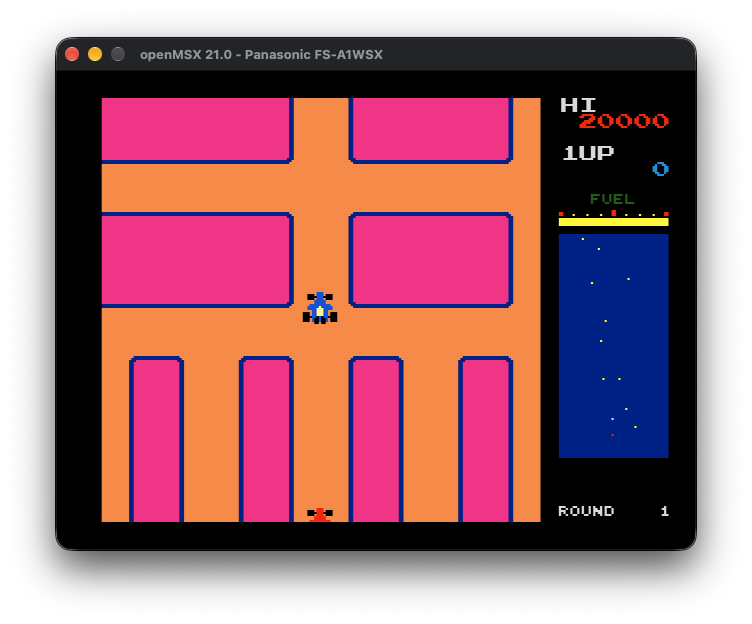

# New Rally-X for MSX2+


A work-in-progress port of the New Rally-X arcade game to MSX2+, focused on
preserving the original graphics and core game rules within a measured MSX timing budget.

The repository provides environment setup, original-graphics tools and a
SCREEN 5 renderer integrating the original Z80 gameplay routines with dynamic
rounds, enemies, smoke and one/two-player sessions. Sound synthesis remains pending.

The port targets **at least 128 KB of RAM mapper and 128 KB VRAM**. The openMSX
launchers use a session-local FS-A1WSX configuration with a 128 KB main mapper.

## Port direction

- Preserve original graphics at **1:1 pixel scale**, including 8x8 tiles and
  16x16 sprites.
- Target a **256x212** display by reducing the visible maze viewport and
  rearranging the HUD and radar. Preserve world coordinates and game rules.
- Prefer retaining the original **Z80 game logic** and adapting its hardware
  interfaces to the MSX2+.
- Use the arcade as the reference for behavior, timing, graphics and sound.
  Rendering performance and sound fidelity still require feasibility measurements
  on the target platform.

## Current status

The default `make build` cartridge provides silent normal/challenge rounds,
original flag/rock placement on four maps, MSX-adapted enemies and native smoke, fuel bonuses,
death/restart, alternating two-player sessions, game over and an autonomous
attract demonstration. It retains original-size graphics, the complete car
drawings, the full HUD and the real V9958 sprite limit.

The eight-pixel header aligns with the maze viewport and shows seven score/high-score
digits, the selected player and two round digits (infinity above 99). Credits use
one digit, capped visually at nine. Native score/round/credit counters retain
their full range. The life digit shows spare cars, capped at nine.
A 248x201 maze viewport preserves world coordinates. The full game targets
**30 FPS presentation** on approximately 60 Hz NTSC output, as approved by the
user. Complete car masks, attributes and both camera axes publish together.
The player, input, fuel and phase clocks target approximately 59.92 Hz; enemy
motion/decisions use doubled fractional steps every other tick. Pursuit is
adapted for the MSX, with decisions at intersections and bounded speeds.
Original art, colors, complete cars and the HUD remain intact. Occasional
missed publication slots and camera waits remain measured separately from
average FPS. See [current measurements and limits](docs/issue12-performance-analysis.md).

```sh
make build
make run
```

Press **5** for a credit, **1** for one player or **2** for two players (two
credits). Both players use arrows or joystick1 on alternating turns. **Space**,
Ctrl or triggerA releases smoke; **P** pauses; Home resets the development run.
With no credits, the original cast screen periodically enters an automatic demo.

Builds use fresh sealed directories under `references/build/default-*/` and
publish `references/build/newrallyx.rom` only after success. `make run` reuses
that file, building it only when missing. Rebuild after changing sources.
`make run LATEST=1` launches the most recent sealed build; named historical
cartridges remain available through `make checkpoints` and
`make run CHECKPOINT=<name>`. An explicit `ROM=<path>` selects another cartridge.

`make build FULL_GAME=0` reconstructs the bounded Issue 11 stage12 reference.
Earlier diagnostic stages remain available with `STAGE=0..11`; their controls,
contracts and historical limitations are in the [checkpoint guide](docs/checkpoints.md).
They do not provide complete-game progression. `NATIVE=1` remains a compatibility
alias for the bounded selected-routine reference.

Validation uses openMSX 21.0, 60 Hz full-game VDP output, a 128 KB RAM mapper and 128 KB
VRAM. The game detects the Panasonic's factory 5.37 MHz mode for pure CPU work;
VDP access and raster IRQs use 3.58 MHz. Other machines retain their base clock;
the reported cadence depends on the factory mode. The launcher uses an isolated FS-A1WSX
configuration and contributor-supplied BIOS under `references/msxbios/`.
See [setup](docs/setup.md#machine-and-contributor-supplied-bios).
Bounded stages retain 50 Hz; `make build HZ=50` explicitly selects that refresh
for a full-game diagnostic.
Validation distinguishes real scanout recordings, source-pixel/VRAM proofs,
natural routes and controlled population fixtures. Physical hardware and full
human gameplay/culling acceptance remain review items.

Use `python3 -B scripts/clean.py --dry-run` to inspect generated build contents.
`make clean` removes local ROMs, checkpoints, reports and emulator sessions under
`references/build/`; preserve evidence you need before cleaning.

## Quick start

Run the following commands from the repository root.

### 1. Prepare the development environment

On macOS, install Xcode Command Line Tools and native Homebrew first. Use a
native Apple Silicon or Intel terminal; Rosetta shells are not supported by the
bootstrap. See the [setup guide](docs/setup.md#macos-prerequisites) for details.

Preview the required changes, then install and verify:

```sh
bash scripts/setup.sh --dry-run
make environment
make environment-check
```

Setup prepares Python/Pillow, a pinned local sjasmplus cross-assembler, z80dasm,
MAME, openMSX, ShellCheck, Git and GitHub CLI. It creates a project-local `.venv`
and stores the managed assembler and smoke-test outputs under `.tools/`.

Setup does not download game ROMs or MSX BIOS ROMs. Emulator availability checks
do not boot an arcade or MSX machine.

### 2. Supply the original ROM set

Place your own **unpacked** `nrallyx` ROM set in:

```text
references/roms/nrallyx/
```

The supported set is pinned to MAME 0.289. All 13 files must match the names,
sizes and checksums in the [ROM inventory](scripts/graphics/nrallyx.json),
including program and sound ROMs that the graphics extractor does not decode.
Other revisions and ZIP input are not supported by this extractor.

### 3. Extract the graphics

```sh
make extract-graphics
```

Output is written to `references/assets/nrallyx/`. It includes original pixel
indices, indexed atlases, color previews, palette and layout metadata, and a
manifest recording source and output hashes. Original dimensions are preserved.

Existing output is protected. To replace a complete, unchanged extraction:

```sh
make extract-graphics OVERWRITE=1
```

To keep an earlier extraction, choose a different destination below
`references/assets/`:

```sh
make extract-graphics GRAPHICS_OUTPUT="references/assets/nrallyx-other"
```

See [graphics extraction](docs/graphics-extraction.md) for input overrides,
output formats, overwrite checks, recovery and optional MAME comparisons.

### 4. Prepare scenes and run the game

Follow the [scene guide](docs/arcade-scenes.md) to capture the reference scenes,
then analyze the normal and overlap captures to generate the approved bundles at `references/scenes/rom-input/normal` and
`references/scenes/rom-input/overlap`. The default build reads captures from
`references/scenes/review-fixed-v3/`; use that path when capturing:

```sh
make prepare-scenes
```

This captures the reference frames first, then analyzes the normal and overlap
frames in order. To run the steps separately, use `make capture-scenes` and
`make analyze-scenes`. Existing destinations are protected by default. Use
`make prepare-scenes OVERWRITE=1` to replace complete, unchanged capture and
analysis bundles with matching payload inventories. Modified bundles, unknown
files, directories or symlinks are preserved and cause an error. Override `SCENES_CAPTURE`,
`SCENES_NORMAL` and `SCENES_OVERLAP` for a fresh run; `GRAPHICS_OUTPUT` selects
the extracted assets. The default build expects the standard paths above.

Reuse existing verified captures and input bundles if present: run only
`make analyze-scenes` if captures already exist, or proceed to `make run` if
both bundles are ready. Supply the compatible BIOS locally, then:

```sh
make run
```

## Commands

| Command | Purpose |
| --- | --- |
| `make environment` | Install dependencies and prepare or verify the local environment |
| `make environment-check` | Verify the environment without installing or rebuilding |
| `make extract-graphics` | Extract original arcade graphics into `references/assets/nrallyx/` |
| `make capture-scenes` | Capture the arcade reference frames with MAME |
| `make analyze-scenes` | Analyze normal and overlap captures into build input bundles |
| `make prepare-scenes` | Capture scenes, then analyze both input bundles in order |
| `make build` | Rebuild and publish `references/build/newrallyx.rom` |
| `make run` | Build if the default ROM is missing, then start openMSX |
| `make test` | Run the automated test suite |
| `make clean` | Remove generated builds and emulator sessions |

Plain `make` is equivalent to `make build`. Renderer verification uses its
script CLIs.

## Repository layout

| Path | Contents |
| --- | --- |
| `docs/setup.md` | Environment prerequisites, toolchain, troubleshooting and validation evidence |
| `docs/graphics-extraction.md` | ROM requirements, extraction schema, provenance and reference checks |
| `docs/full-gameplay-inventory.md` | Complete-game integration, evidence and remaining limits |
| `docs/raster-scroll.md` | Renderer baseline, controls, memory ownership, integration contract and measured timing |
| `docs/hud.md` | Reusable HUD API, initialization, scheduling and original-game adapter |
| `docs/player.md` | Original player movement, driving controls, sprites and raster integration |
| `docs/stage-one-map.md` | Exact first-stage reconstruction, native checks and hidden-tile streaming |
| `scripts/environment/` | macOS provisioning support and toolchain verification |
| `scripts/graphics/` | ROM inventory, graphics decoding/export and MAME reference harness |
| `scripts/extract_graphics.py` | Graphics-extraction CLI |
| `tests/` | Automated tests and synthetic fixtures |
| `references/roms/` | Local contributor-supplied ROMs; ignored by Git |
| `references/assets/` | Local extracted graphics; ignored by Git |
| `references/disassembly/` | Local disassembly material; ignored by Git |
| `.venv/`, `.tools/` | Generated environment, managed tools and smoke-test cache; ignored by Git |

Use the setup, extraction, map and renderer guides for the supported workflow.

## Validation and contributions

Capture real arcade gameplay, reconstruct native frames and generate the approved
256x212 compact reference layout with `scripts/arcade_scene.py capture` and
`analyze`. These input bundles use the earlier 200x212 maze and 56-pixel sidebar;
the current ROM recomposes their original-size assets into the raster layout. See the
[arcade scene guide](docs/arcade-scenes.md) for commands, synchronization evidence,
comparison results and SCREEN 4/5 constraints. Captures and previews remain local.

The automated tests use synthetic fixtures and do not require original game data.
Run them after preparing the environment:

```sh
make test
git diff --check
```

Local comparisons against the original game require contributor-supplied ROMs and
MAME. Reproduction commands and limitations are documented in the
[player guide](docs/player.md#verification), [HUD guide](docs/hud.md#verification)
and [extraction guide](docs/graphics-extraction.md#synthetic-tests-and-optional-local-mame-validation).

Keep documentation, issue bodies and code in English. Read [AGENTS.md](AGENTS.md)
before changing the repository or managing GitHub work.

## Original game data

ROMs, extracted assets, disassembly and captures must remain local under ignored
`references/` directories. Only directory markers are tracked there. Commit
tools, documentation, metadata and synthetic fixtures; never commit original
game data, including data embedded in test fixtures.

Contributors supply their own ROMs. Project tools must not download or
redistribute game ROMs or proprietary BIOS images. No permission to redistribute
original game data is granted by this repository.
